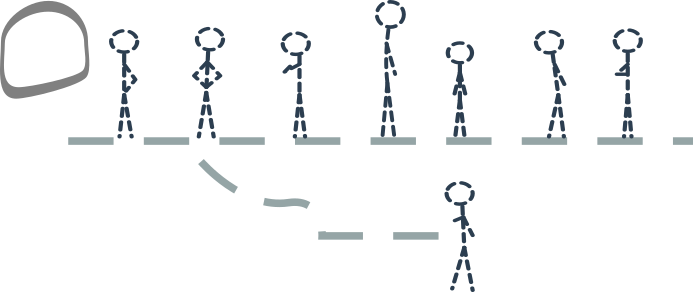

# LB-10. Оцінка ефективності обробки черги 

## 1. Локальні зміни.

- Створити на вашому локальному диску вашу персональну теку (наприклад: `LB-10\MaxVoronoy`)
- Використовуючи улюблену мову програмування оцінити час закінчення черги фіксованої довжини.

## 2. Зміст роботи

Наступна дві діаграми демонструють 2 можливих черги (чесна та з чітером).

Треба написати скрипт, який емулює 2 процеси обслуговування та розраховує:
- Час коли черга фіксованої довжини закінчиться
- Середній час очікування 1-єї людини. 

Дія касиру:
- взяти гроші у покупця (та перевірити чи достатньо);
- видати товар;
- 50/50 видати решту.

Дія чітера:
- дати суму якої точно достатньо;
- якщо більше, відповісти: "та нехай вам залишиться".

Розрахувати числа на великій кількості запусків, та надати результат у вигляді текстового файлу.

## 3. Зробити зміни доступними для загалу

На цей момент ви маєте 2 файли (наприклад `LB-10\MaxVoronoy\queue.py`, `LB-10\MaxVoronoy\results.txt`) 

- За допомогою середовища зробіть commit.
- Обов'язково опішить коментар, що зроблено.
- Перевірити актуальність вашого локального репозитарію
- Треба впевнитись, що ваші зміни не конфліктують з віддаленими, для цього ще раз виконуємо команду `pull` 
([дивись](../LB-1/README.md) лабу #1).
- Перемістити локальні зміни на віддалений репозитарій.
- Спробувати виконати команду `push` (конфліктів, скоріш за все, не повинно бути).
