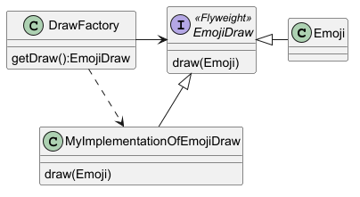

# LB-6.  Design patterns (Structural)

## 1. Локальні зміни.

- Створити на вашому локальному диску вашу персональну теку (наприклад: `LB-6\MaxVoronoy`)
- Використайте вашу улюблену мову програмування для створення вашого розуміння шаблону Flyweight. 

## 2. Зміст роботи

Необхідно розробити програму, яка забезпечує відображення емодзі за їхніми символьними ідентифікаторами.

Уявімо, що існує умовний файл emoji.db, який містить велику кількість описів емодзі. Кожен опис містить ідентифікатор емодзі та відповідну інформацію, необхідну для його відображення (наприклад, Unicode-послідовність або графічні дані).

Програма повинна підтримувати запити такого типу:
- draw symbol-A
- draw symbol-B
- draw symbol-A
- draw symbol-C
- draw symbol-B
- draw symbol-A

У відповідь на кожен запит програма повинна знаходити відповідний опис у сховищі та виводити відповідне емодзі.

Наприклад:

- draw symbol-A -> 😀
- draw symbol-B -> 🚀
- draw symbol-A -> 😀
- draw symbol-C -> ❤️
- draw symbol-B -> 🚀
- draw symbol-A -> 😀

2. Вимоги до реалізації
Необхідно реалізувати рішення з використанням патерна Flyweight.

Основна ідея полягає в тому, що завантаження та створення об'єктів, які описують емодзі, повинно відбуватися лише один раз для кожного унікального символу.

Для цього необхідно передбачити такі компоненти:
1. Emoji (Flyweight) — об'єкт, який містить незмінний опис конкретного емодзі та реалізує операцію його відображення.
2. EmojiFactory (Flyweight Factory) — фабрика, яка відповідає за створення та повторне використання об'єктів Emoji. Якщо об'єкт для запитаного символу вже існує, фабрика повинна повернути наявний екземпляр замість створення нового.
3. EmojiDatabase — умовне сховище описів емодзі. Для спрощення допускається використовувати звичайний текстовий файл.
4. Client — основна частина програми, яка отримує команди користувача, звертається до фабрики та ініціює відображення емодзі.
3. Основний сценарій роботи
Програма повинна виконувати наступний алгоритм:
1. Отримати команду користувача із зазначенням ідентифікатора емодзі.
2. Перевірити, чи існує відповідний об'єкт у фабриці Flyweight.
3. Якщо об'єкт вже створений, отримати посилання на нього.
4. Якщо об'єкта ще немає, завантажити його опис зі сховища, створити новий об'єкт та зареєструвати його у фабриці.
5. Викликати операцію відображення емодзі.
4. Додаткові вимоги
- Мова програмування та архітектура програми обираються студентом самостійно.
- Кількість описів емодзі у сховищі повинна бути достатньо великою, щоб продемонструвати доцільність повторного використання об'єктів.
- Фабрика повинна гарантувати, що для одного ідентифікатора не створюється декілька екземплярів Flyweight.
- Необхідно передбачити обробку ситуації, коли запитуваний ідентифікатор відсутній у сховищі.
- Для спрощення допускається використовувати Unicode-символи замість повноцінних графічних ресурсів.

### Що важливо показати

- Коректну роботу програми для декількох різних емодзі.
- Повторне використання одного й того самого об'єкта при повторних запитах.
- Завантаження опису емодзі лише під час першого звернення до нього (Lazy Initialization).
- Відсутність повторного створення об'єктів для вже завантажених емодзі.

## 3. Зробити зміни доступними для загалу

На цей момент ви маєте 1 новий файл (`LB-6\MaxVoronoy\flyweight.cpp`) 

- За допомогою середовища зробіть commit цьому файлу
Обов'язково опішить коментар, що зроблено.

- Перевірити актуальність вашого локального репозитарію  

Треба впевнитись, що ваші зміни не конфліктують з віддаленими, для цього ще раз виконуємо команду `pull` 
([дивись](../LB-1/README.md) лабу #1).

- Перемістити локальні зміни на віддалений репозитарій.
Спробувати виконати команду `push` (конфліктів, скоріш за все, не повинно бути).
