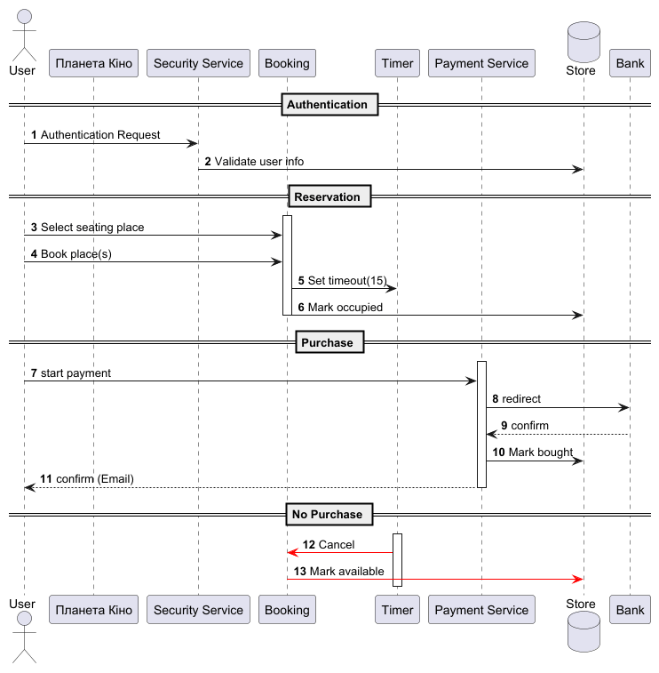

# LB-9. Розробити UML State-diagram для процесу придбання квіткив 

## 1. Локальні зміни.

- Створити на вашому локальному диску вашу персональну теку (наприклад: `LB-9\MaxVoronoy`)
- Використивоючи Plnat-UML створити State-Diagram для процесу покупки квіткив.

## 2. Зміст роботи

Наступна діаграма послідовностей описує  сценарій придбання квіткив.

Треба створити діаграму стану для процесу (purchase-ticket-state.puml). 

## 3. Зробити зміни доступними для загалу

На цей момент ви маєте 1 файл (наприклад `LB-9\MaxVoronoy\purchase-ticket-state.puml`) 

- За допомогою середовища зробіть commit.
- Обов'язково опішить коментар, що зроблено.
- Перевірити актуальність вашого локального репозитарію
- Треба впевнитись, що ваші зміни не конфліктують з віддаленими, для цього ще раз виконуємо команду `pull` 
([дивись](../LB-1/README.md) лабу #1).
- Перемістити локальні зміни на віддалений репозитарій.
- Спробувати виконати команду `push` (конфліктів, скоріш за все, не повинно бути).
